# Conveyor Belt Design

**A belt conveyor for a production line, designed in SolidWorks: frame, rollers, bearing units and a collection box at the end of the line.**

Ahmed Mohamed Elanany

  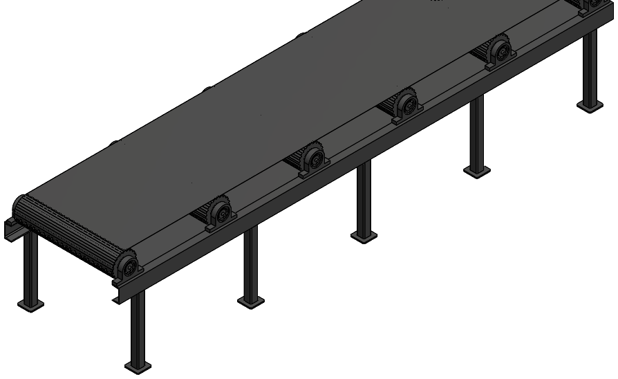

## All parts

  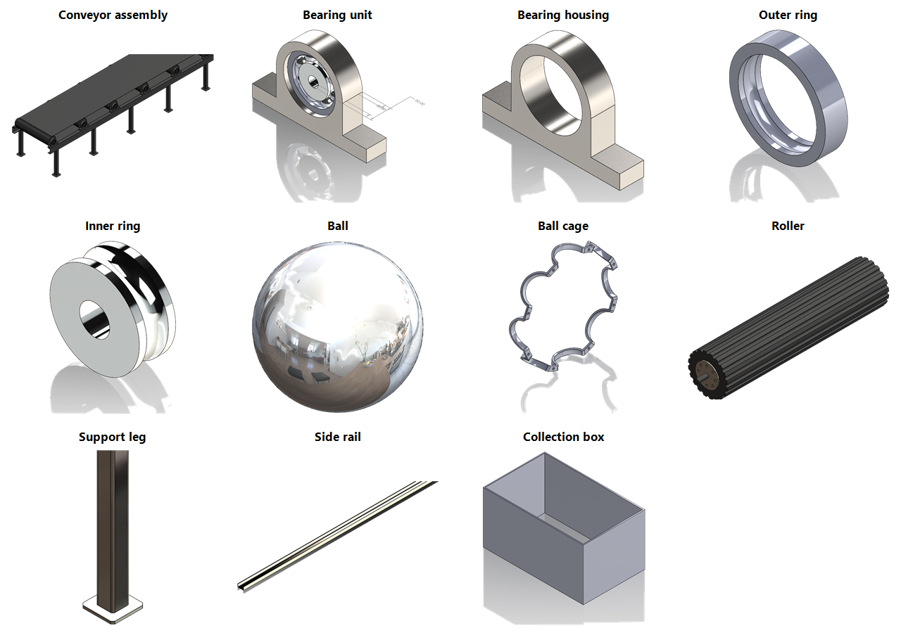

| Part | File | Picture |
| --- | --- | --- |
| Conveyor assembly | `Assem1.SLDASM` |  |
| Bearing unit (sub-assembly) | `ball bearing.SLDASM` | 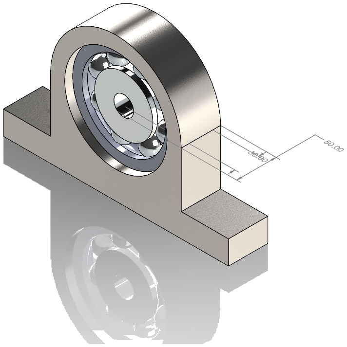 |
| Bearing housing (pillow block) | `el zeyada.SLDPRT` | 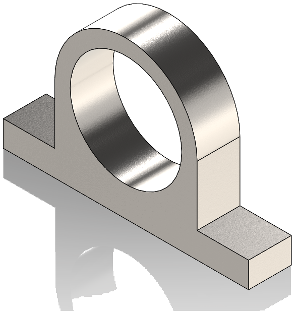 |
| Outer ring | `outer bearing.SLDPRT` | 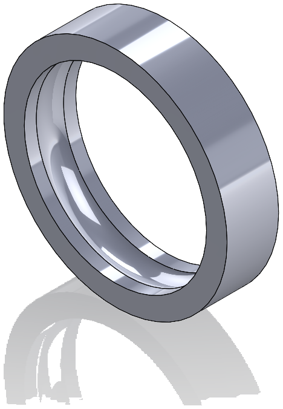 |
| Inner ring | `bearing inner.SLDPRT` | 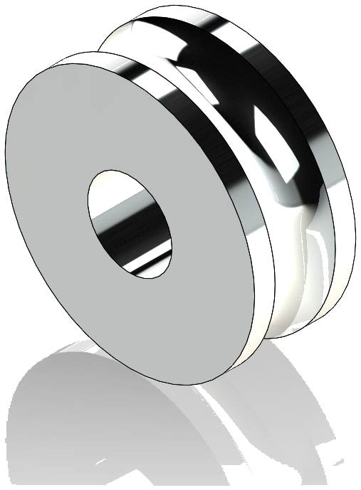 |
| Ball | `bearing ball.SLDPRT` |  |
| Ball cage | `shield.SLDPRT` | 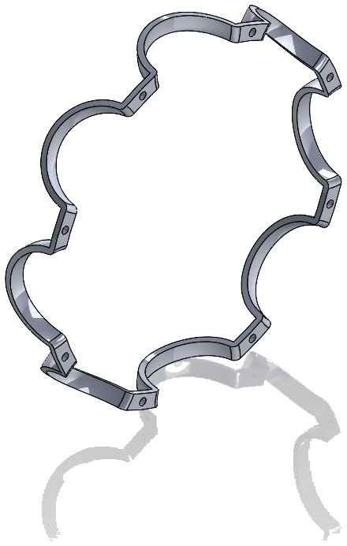 |
| Roller | `shaft.SLDPRT` | 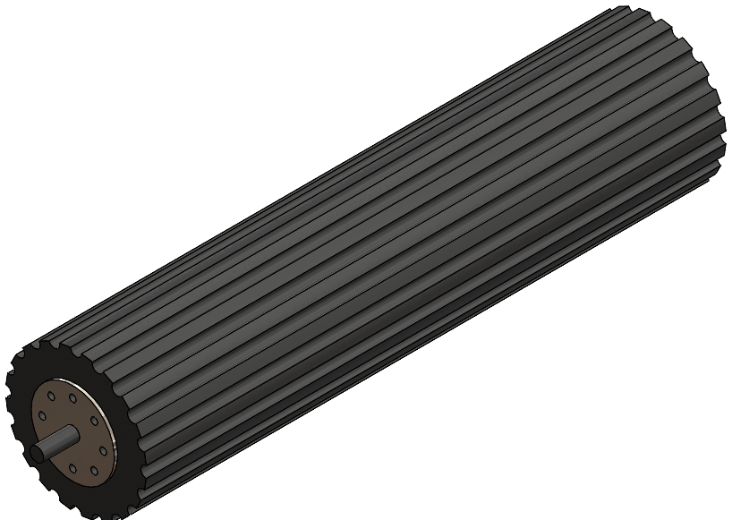 |
| Support leg | `a3da.SLDPRT` | 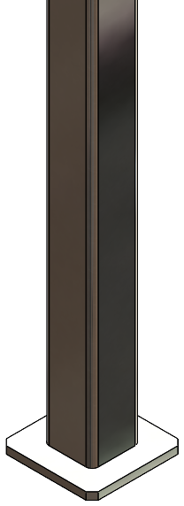 |
| Side rail | `maarafsh esmaha.SLDPRT` | 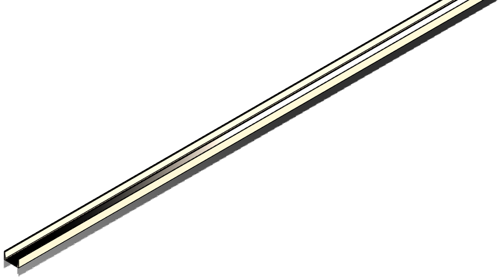 |
| Collection box | `box.SLDPRT` | 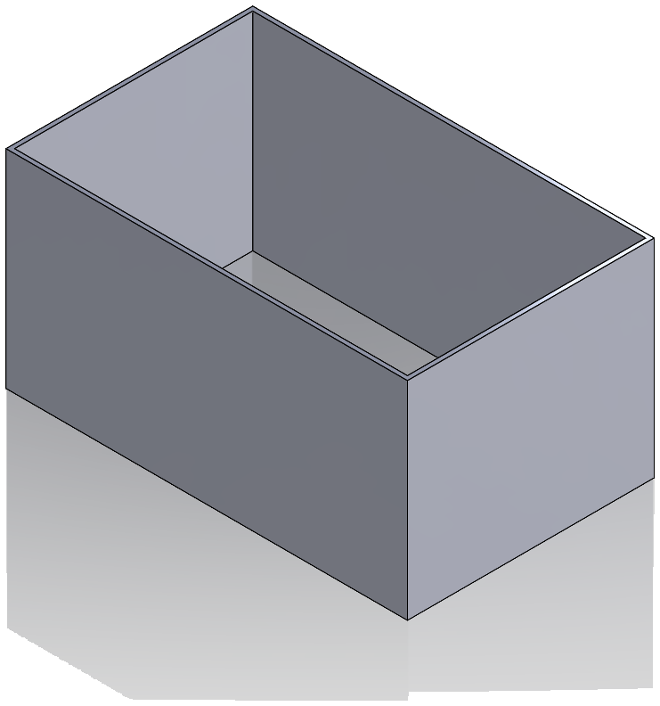 |

## Design

- **Frame:** square-tube support legs with base plates carry the side rails along the full length of the line.
- **Rollers:** grooved rollers drive and carry the belt.
- **Bearings:** every roller runs in a pillow-block bearing unit. The ball bearing was modelled part by part: housing, outer ring, inner ring, balls and cage.
- **Collection box:** catches the products at the end of the line.

## Files

All SolidWorks files are in [`cad/`](cad). Download the whole folder and open `Assem1.SLDASM`; the assembly finds its parts in the same folder.

## Author

**Ahmed Mohamed Elanany** · [LinkedIn](https://www.linkedin.com/in/ahmed-elanany) · ahmedelanany34@gmail.com
